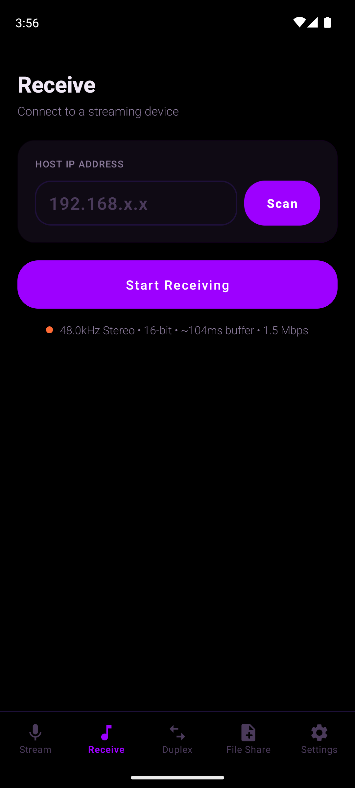
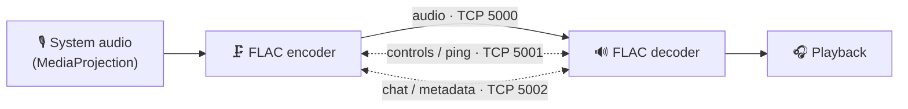

<div align="center">

# 🔊 SoundShare

**Real-time, high-fidelity audio streaming between Android devices over local Wi-Fi.**

*Capture system audio from any app, stream it losslessly to one or many receivers, chat while you listen, and control playback remotely — up to Hi-Res 192 kHz / 24-bit.*

[](https://developer.android.com)
[](https://developer.android.com/about/versions/12)
[](https://developer.android.com)
[](#)
[](https://gradle.org)
[](#-network-protocol)

</div>

<p align="center">
  <a href="#-features">Features</a> •
  <a href="#-how-it-works">How it works</a> •
  <a href="#-network-protocol">Protocol</a> •
  <a href="#-quality-presets">Presets</a> •
  <a href="#-getting-started">Getting started</a> •
  <a href="#-web-ui">Web UI</a> •
  <a href="#-project-structure">Structure</a> •
  <a href="#-knowledge-graph">Knowledge graph</a>
</p>

---

## ✨ Features

| | |
|:---:|---|
| 🎙️ **System-wide audio capture** | Grabs audio from any app via the **MediaProjection** API |
| 📡 **Multi-receiver streaming** | One host → many listeners over local TCP/IP Wi-Fi |
| 🎼 **Hi-Res Audio** | Up to **192 kHz / 24-bit** for audiophile-grade listening |
| 🗜️ **FLAC lossless** | Bit-perfect audio with efficient bandwidth usage |
| 🔄 **Duplex mode** | Full bidirectional audio between two devices |
| 💬 **Live chat & metadata** | Two-way chat plus track metadata broadcast |
| 🎮 **Transport controls** | Pause / resume / skip from any receiver |
| ⚙️ **Deep performance tuning** | Adjustable buffers and quality presets for any network |

<!-- 📸 Screenshots: drop images into docs/ and uncomment
<p align="center">
  
  
  
  
</p>
-->

---

## 🗺️ How it works



A single-Activity app with four bottom-navigation tabs:

| Tab | Mode | What it does |
|---|---|---|
| 📤 **Stream** | Host / sender | Captures system audio and broadcasts it |
| 📥 **Receive** | Client / receiver | Decodes and plays incoming streams |
| 🔁 **Duplex** | Bidirectional | Simultaneous send + receive between two devices |
| ⚙️ **Settings** | Tuning | Buffers, presets and performance options |

---

## 📡 Network protocol

Custom binary protocol **v2** — 28-byte header, magic `SSHD`.

| Port | Purpose |
|:---:|---|
| `5000` | Main audio data stream |
| `5001` | Ping / latency + transport control (pause / resume / skip) |
| `5002` | Chat + metadata broadcast |
| `5003` | Duplex audio |
| `5004` | Duplex chat |

---

## 🎚️ Quality presets

Seven one-tap presets, from battery-saver to audiophile:

| Preset | Sample rate | Channels | Bit depth |
|---|:---:|:---:|:---:|
| Ultra Low | 44.1 kHz | Mono | 16-bit |
| ⭐ **Balanced** *(default)* | 48 kHz | Stereo | 16-bit |
| Hi-Res Ultra | 192 kHz | Stereo | 24-bit |

*…plus four intermediate presets in between.*

---

## 🚀 Getting started

### Prerequisites

- Android Studio (or Android SDK command-line tools)
- JDK 11+
- Android SDK with API 36

### Build & run

```bash
# Build
./gradlew assembleDebug          # Debug APK
./gradlew assembleRelease        # Release APK

# Install on a connected device
./gradlew installDebug

# Tests
./gradlew test                   # Local unit tests
./gradlew connectedAndroidTest   # Instrumented tests
```

> 💡 Host and receiver devices must be on the **same local Wi-Fi network**.

---

## 🖥️ Web UI

A responsive recreation of the mobile UI lives in [`web-ui/`](web-ui/) — vanilla HTML/CSS/JS, **no build step required**.

- 🌗 Playful OLED theme with dark / light toggle
- 🧭 4-tab navigation: Stream · Receive · Duplex · Settings
- 📱💻 Responsive from 375 px to 1440 px with animated transitions
- 📊 Simulated live stats, chat with auto-replies, transport controls
- ♿ Fully accessible: ARIA roles, keyboard navigation, reduced-motion support

```bash
# Open directly in a browser
open web-ui/index.html        # macOS
xdg-open web-ui/index.html    # Linux
start web-ui/index.html       # Windows

# Or serve locally
cd web-ui && python3 -m http.server 8765   # → http://localhost:8765
```

---

## 📁 Project structure

```
SoundShare/
├── app/                  # Android app module (Java)
│   └── src/              # Activities, fragments, services, FLAC codec
├── gradle/               # Wrapper + version catalog (libs.versions.toml)
├── web-ui/               # Web recreation of the mobile UI (HTML/CSS/JS)
├── graphify-out/         # Generated architecture knowledge graph
├── build.gradle.kts      # Root build script (Kotlin DSL)
├── settings.gradle.kts   # Module configuration
└── gradle.properties
```

---

## 🧠 Knowledge graph

This repo ships with a graphify knowledge graph for architecture reference in [`graphify-out/`](graphify-out/):

- `graph.json` — machine-readable graph
- `GRAPH_REPORT.md` — human-readable architecture report

Rebuild after code changes:

```bash
graphify . --obsidian --obsidian-dir ~/vaults/soundshare_v1
```

---

<div align="center">

**Java · Android 12+ · Gradle 8.13 (Kotlin DSL) · AGP 8.13.2 · TCP/IP · FLAC**

*SoundShare — because great sound should follow you around the house.* 🏠🎶

</div>

<!-- TODO: add a LICENSE file and a license badge once ready -->