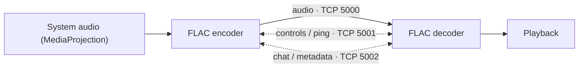

```markdown
<div align="center">

# SoundShare

**Real-time, high-fidelity audio streaming between Android devices over local Wi-Fi.**

*Capture system audio from any app, stream it losslessly to one or many receivers, chat while you listen, and control playback remotely — up to Hi-Res 192 kHz / 24-bit.*

[](https://developer.android.com)
[](https://developer.android.com/about/versions/12)
[](https://developer.android.com)
[](#)
[](https://gradle.org)

</div>

<p align="center">
  <a href="#features">Features</a> •
  <a href="#architecture">Architecture</a> •
  <a href="#network-protocol">Protocol</a> •
  <a href="#quality-presets">Presets</a> •
  <a href="#getting-started">Getting started</a> •
  <a href="#project-structure">Structure</a> •
  <a href="#knowledge-graph">Knowledge graph</a>
</p>

---

## Features

| Feature | Description |
|---|---|
| **System-wide audio capture** | Grabs audio from any app via the MediaProjection API. |
| **Multi-receiver streaming** | One host broadcasts to many listeners over local TCP/IP Wi-Fi. |
| **Hi-Res Audio** | Supports up to 192 kHz / 24-bit for audiophile-grade listening. |
| **FLAC lossless** | Bit-perfect audio with efficient bandwidth usage. |
| **Duplex mode** | Full bidirectional audio between two devices. |
| **Live chat & metadata** | Two-way chat plus track metadata broadcast. |
| **Transport controls** | Pause, resume, and skip from any receiver. |
| **Deep performance tuning** | Adjustable buffers and quality presets for any network environment. |

---

## Architecture

A single-Activity application utilizing a multi-Fragment design with a `BottomNavigationView` (4 tabs). All fragments communicate with `MainActivity` via callback interfaces.

| Tab | Mode | Description |
|---|---|---|
| **Stream** | Host / sender | Captures system audio and broadcasts it. |
| **Receive** | Client / receiver | Decodes and plays incoming streams. |
| **Duplex** | Bidirectional | Simultaneous send and receive between two devices. |
| **Settings** | Tuning | Buffers, presets, and performance options. |

### Data Flow



---

## Network Protocol

SoundShare utilizes a custom binary protocol (v2) featuring a 28-byte header and the magic string `SSHD`. Communication is distributed across five dedicated TCP ports:

| Port | Purpose |
|:---:|---|
| `5000` | Main audio data stream |
| `5001` | Ping / latency measurement and transport control (pause / resume / skip) |
| `5002` | Chat and metadata broadcast |
| `5003` | Duplex audio stream |
| `5004` | Duplex chat stream |

---

## Quality Presets

Seven one-tap presets are available, ranging from battery-saver modes to high-resolution audio:

| Preset | Sample Rate | Channels | Bit Depth |
|---|:---:|:---:|:---:|
| Ultra Low | 44.1 kHz | Mono | 16-bit |
| **Balanced** *(default)* | 48 kHz | Stereo | 16-bit |
| Hi-Res Ultra | 192 kHz | Stereo | 24-bit |

---

## Getting Started

### Prerequisites

- Android Studio (or Android SDK command-line tools)
- JDK 11 or higher
- Android SDK with API 36

### Build and Run

```bash
# Build the application
./gradlew assembleDebug          # Debug APK
./gradlew assembleRelease        # Release APK

# Install on a connected device
./gradlew installDebug

# Run tests
./gradlew test                   # Local unit tests
./gradlew connectedAndroidTest   # Instrumented tests
```

*Note: Host and receiver devices must be connected to the same local Wi-Fi network.*

---

## Project Structure

```text
SoundShare/
├── app/                  # Android app module (Java)
│   └── src/              # Activities, fragments, services, FLAC codec
├── gradle/               # Wrapper and version catalog (libs.versions.toml)
├── graphify-out/         # Generated architecture knowledge graph
├── build.gradle.kts      # Root build script (Kotlin DSL)
├── settings.gradle.kts   # Module configuration
└── gradle.properties     # Gradle properties
```

---

## Knowledge Graph

This repository includes a graphify-generated knowledge graph for architecture reference, located in the `graphify-out/` directory:

- `graph.json` — Machine-readable graph data
- `GRAPH_REPORT.md` — Human-readable architecture report

To rebuild the vault after making code changes:

```bash
graphify . --obsidian --obsidian-dir ~/vaults/soundshare
```

---

<div align="center">

**Java · Android 12+ · Gradle 8.13 (Kotlin DSL) · AGP 8.13.2 · TCP/IP · FLAC**

</div>
```